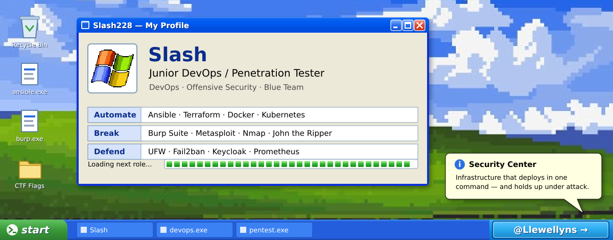
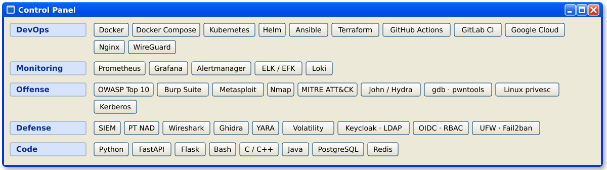
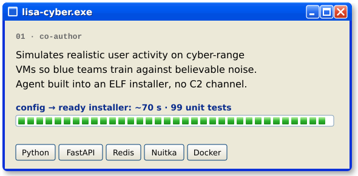
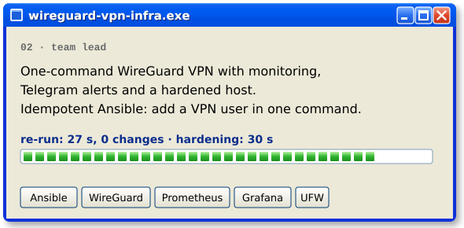
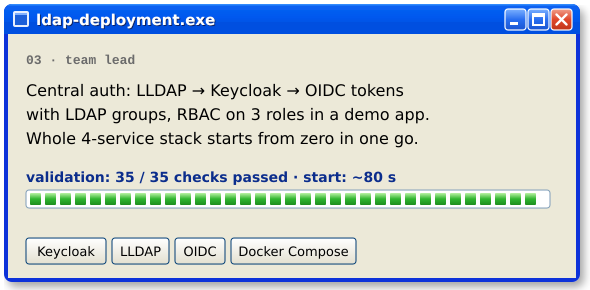
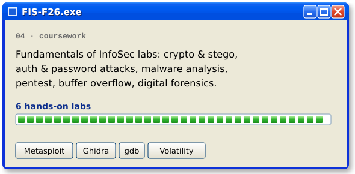
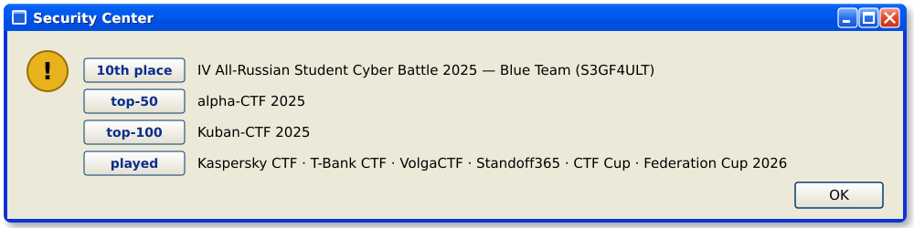

  

Cybersecurity student working on both sides of the same server.
I automate infrastructure so it deploys in one command, then attack it the way a pentester would: web application testing against the OWASP Top 10, Linux privilege escalation, Active Directory and Kerberos attacks, password cracking.
Team lead on infrastructure projects; Blue Team at the All-Russian Student Cyber Battle.

- Building one-command, idempotent infrastructure with **Ansible**, **Terraform** and **Docker**, shipped through **GitHub Actions / GitLab CI**
- Hardening what I deploy: **UFW · Fail2ban · SSH**, SSO with **Keycloak + LDAP**, alerts in **Prometheus + Grafana**
- Learning: **Kubernetes** in production, malware analysis and binary exploitation (FIS-F26 course)

  

  
  

  
  

  

  

